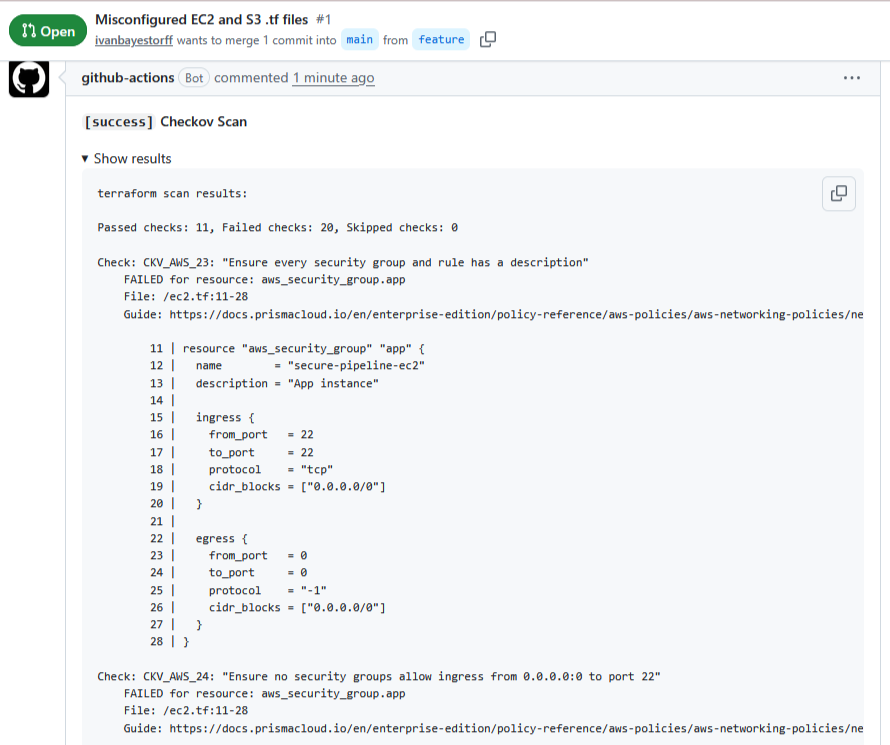
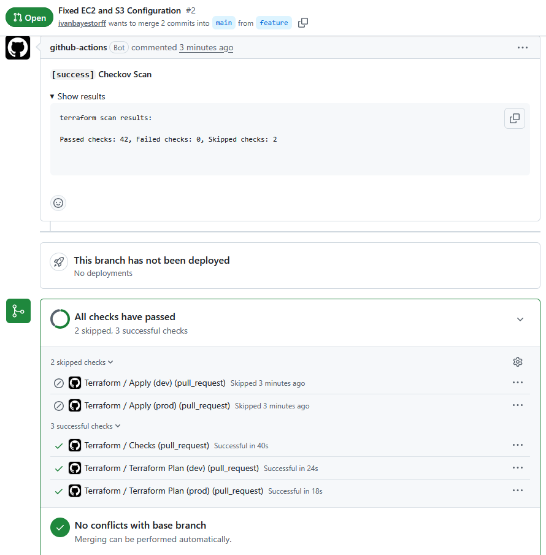
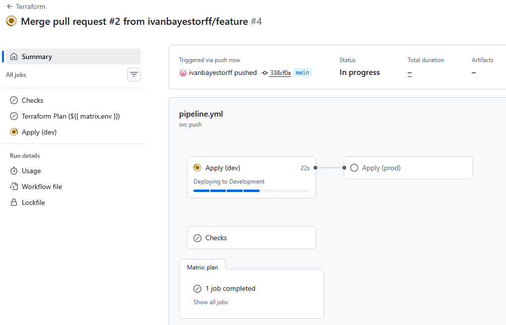
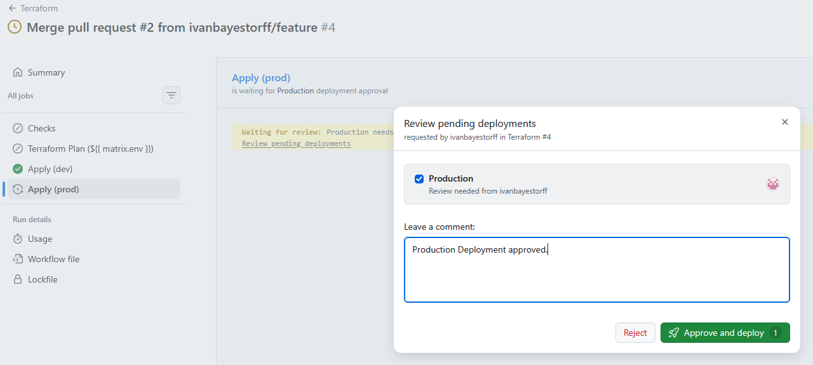
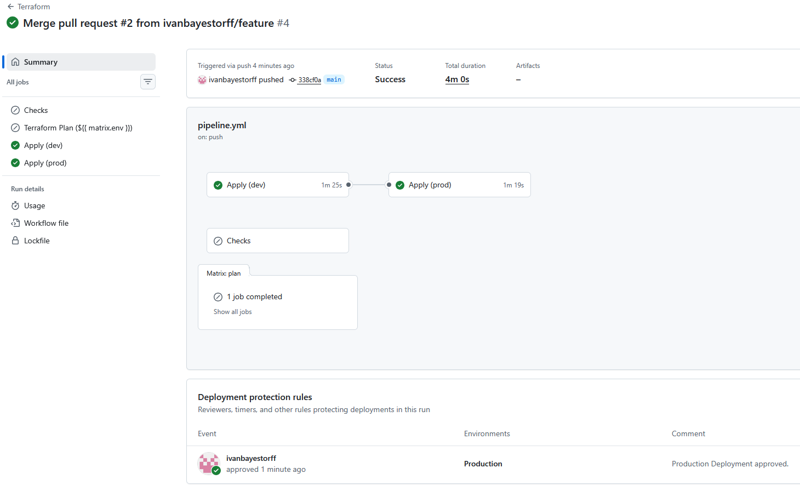

<h1 align="center">Secure CI/CD Pipeline for AWS Deployments via Terraform</h1>

  
  
  
  
  

## Overview

This project is a secure, multi-environment, multi-account CI/CD pipeline for AWS infrastructure, built with Terraform and GitHub Actions. The development and production environments live in separate AWS accounts.

Resources created by hand in the console (ClickOps) are hard to review and audit. A public S3 bucket or an unencrypted volume can go live without anyone noticing, and over time environments drift apart because nobody knows exactly what changed or when. Moving from ClickOps to an automated, versioned and repeatable setup means every change goes through code first.

When a pull request that changes `terraform/` is opened or updated, the **Checks** job runs TFLint and Checkov, while the **Terraform Plan** job runs `terraform plan` for dev and prod in parallel. Each result is posted to the pull request as a comment, so before any infrastructure is provisioned, a reviewer can see what will be created or changed and which resource settings are non-compliant.

Once the pull request is merged, the changes are deployed to the Development account. The Production deployment then waits until for a second approval before it is deployed to the Production environment.

## Architecture

## Design Decisions

- **No long-lived credentials:** GitHub Actions authenticates to both AWS accounts through OIDC federation, so no access keys are stored in GitHub.
- **No AWS access for static checks:** only the plan and apply jobs can request an OIDC token; linting, scanning and validate never connect to AWS.
- **Separate roles for plan and apply in each account:** pull requests only use a read-only role, for `terraform plan`. The write role for `terraform apply` is only used by the apply jobs, which run only after a merge to `main`.
- **Two gates before production:** dev is deployed as soon as the pull request is merged; prod also needs an extra approval on the Production environment.
- **Changes only through pull requests:** a branch ruleset on `main` requires a pull request and blocks force pushes and branch deletion, with no bypass allowed.
- **Checkov is advisory:** it runs in soft-fail mode, so its findings are reported on the pull request to be reviewed, but never fail the job.
- **Separate state per environment:** each environment keeps its Terraform state in its own S3 bucket, with S3 native state locking.

## Results

To test the pipeline, an EC2 instance and an S3 bucket were first written with common security misconfigurations and opened as a pull request. The fixed version was then opened as a second pull request and deployed to both accounts. The table compares the Checkov results and Terraform plans that the pipeline posted on each pull request.

The two skipped checks are accepted exceptions, marked with `#checkov:skip` in [`s3.tf`](terraform/s3.tf): access logging (`CKV_AWS_18`) and cross-region replication (`CKV_AWS_144`). Each one needs an extra bucket (a log bucket, or a replica in another region), which is too much for a short-lived demo bucket.

| Pull request | Passed | Failed | Skipped | Plan (each environment) |
|---|---|---|---|---|
| [#1](https://github.com/ivanbayestorff/aws-secure-pipeline/pull/1) Misconfigured (closed) | 11 | 20 | 0 | 5 to add |
| [#2](https://github.com/ivanbayestorff/aws-secure-pipeline/pull/2) Fixed (merged) | 42 | 0 | 2 | 12 to add |

Show all 20 findings

| Check | Finding in #1 | Fix in #2 | Result in #2 |
|---|---|---|---|
| `CKV_AWS_24` | SSH (port 22) open to `0.0.0.0/0` | Security group removed, access through SSM instead of SSH | Removed |
| `CKV_AWS_382` | All outbound traffic open to `0.0.0.0/0` | Security group removed | Removed |
| `CKV_AWS_23` | Security group rules without a description | Security group removed | Removed |
| `CKV_AWS_88` | Public IP on the instance | `associate_public_ip_address = true` removed | Passed |
| `CKV_AWS_79` | IMDSv1 allowed | `http_tokens = "required"` (IMDSv2 only) | Passed |
| `CKV_AWS_8` | Unencrypted root volume | `encrypted = true` | Passed |
| `CKV2_AWS_41` | No IAM role on the instance | Instance profile with `AmazonSSMManagedInstanceCore` | Passed |
| `CKV_AWS_126` | Detailed monitoring off | `monitoring = true` | Passed |
| `CKV_AWS_135` | Not EBS optimized | `ebs_optimized = true` | Passed |
| `CKV_AWS_53` | Public ACLs not blocked | `block_public_acls = true` | Passed |
| `CKV_AWS_54` | Public bucket policies not blocked | `block_public_policy = true` | Passed |
| `CKV_AWS_55` | Public ACLs not ignored | `ignore_public_acls = true` | Passed |
| `CKV_AWS_56` | Public bucket access not restricted | `restrict_public_buckets = true` | Passed |
| `CKV2_AWS_6` | Bucket without an effective public access block | All four settings above set to `true` | Passed |
| `CKV_AWS_145` | Bucket not encrypted with KMS by default | Default encryption with SSE-KMS | Passed |
| `CKV_AWS_21` | Versioning off | Versioning enabled | Passed |
| `CKV2_AWS_61` | No lifecycle configuration | Lifecycle rule: objects expire after 90 days, old versions after 30 | Passed |
| `CKV2_AWS_62` | No event notifications | EventBridge notifications enabled | Passed |
| `CKV_AWS_18` | Access logging off | Accepted exception | Skipped |
| `CKV_AWS_144` | No cross-region replication | Accepted exception | Skipped |

**Removed**: the resource that failed the check no longer exists, so there is nothing left for Checkov to evaluate.

## Screenshots

The test from [Results](#results) as it ran on GitHub, from the misconfigured pull request to the approved production deployment.

<b>1. Misconfigured pull request:</b> Checkov reports 11 passed and 20 failed checks on #1.

Show screenshot

 

<b>2. Fixed pull request:</b> on PR #2, Checkov reports 42 passed, 0 failed and 2 skipped.

Show screenshot

 

<b>3. Merge to <code>main</code>:</b> the merge starts the deployment. Apply (dev) deploys to the Development environment.

Show screenshot

 

<b>4. Production approval:</b> with dev deployed, Apply (prod) pauses until the Production environment's required reviewer approves it.

Show screenshot

 

<b>5. Deployment complete:</b> both apply jobs succeeded, and the approval is recorded on the run under Deployment protection rules.

Show screenshot

